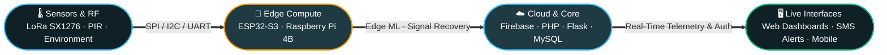

<div align="center">


<a href="https://mshayandev.github.io">
  
</a>

<br/>

<a href="https://mshayandev.github.io"></a>
<a href="https://linkedin.com/in/mshayandev"></a>
<a href="mailto:officialm.shayan@gmail.com"></a>
<a href="https://nexsys.live"></a>


</div>

---

## ⚡ `$ whoami --verbose`

```yaml
engineer:
  name:       "Mohammad Shayan"
  base:       "Karachi, Pakistan 🇵🇰"
  education:
    - degree: "B.E. Telecommunications Engineering @ NED University"   # Sep 2022 – Aug 2026
    - diploma: "Advanced Diploma in Software Engineering @ Aptech"     # Sep 2022 – Oct 2025
  active_rx:  "SHARC — AI cognitive radio that heals its own RF link"
  experience: "Azfam Technologies — IoT Web Development Intern"        # Dec 2025 – Jan 2026
  sweet_spot: "The seam between RF hardware and the web dashboard watching it"
  ask_about:  [ IoT, Embedded Systems, LoRa, Wireless Comms, Edge ML, Full-Stack Web ]
  languages:  { English: "Fluent", Urdu: "Native" }
```

> 💡 **The Philosophy:** I build the whole vertical slice—sensors and radios at the bottom, a browser at the top, and every protocol in between. Two national IoT competitions later (*one 1st-place win, one podium*), I'm still convinced the best engineering problems live right where firmware meets HTTP.

<details>
<summary>📡 <b>Click to inspect my vertical slice</b> — <i>How my systems talk from silicon to browser</i></summary>

<br/>



</details>

---

## 🛠️ Toolbox & Stack

<div align="center">

**Firmware, Languages & Core Web**
<br/>


<br/>

**Hardware, Databases & Ops**
<br/>


</div>

<br/>

<details>
<summary>🔍 <b>The Honest Breakdown</b> — <i>What I reach for daily vs. what I've shipped in the wild</i></summary>

<br/>

| Layer | 🔥 Daily Drivers (Fluent) | 🧪 Shipped / Working Knowledge |
| :--- | :--- | :--- |
| **Languages** | <kbd>Python</kbd> <kbd>JavaScript</kbd> <kbd>PHP</kbd> <kbd>C / C++</kbd> | <kbd>Embedded C</kbd> <kbd>Dart</kbd> <kbd>Verilog</kbd> |
| **Hardware & IoT** | <kbd>ESP32 / ESP32-S3</kbd> <kbd>Raspberry Pi 4B</kbd> <kbd>Arduino</kbd> <kbd>Sensors & Relays</kbd> | <kbd>STM32</kbd> <kbd>FPGA (Quartus)</kbd> <kbd>RTOS</kbd> |
| **Wireless & Telecom** | <kbd>LoRa SX1276/SX1278</kbd> <kbd>SIP / RTP</kbd> <kbd>Wireshark</kbd> <kbd>SIPp</kbd> | <kbd>Radar & CNS Systems</kbd> <kbd>RF Spectrum Analysis</kbd> |
| **Backend & Data** | <kbd>PHP</kbd> <kbd>Flask</kbd> <kbd>MySQL</kbd> <kbd>Firebase</kbd> <kbd>REST & Auth Flows</kbd> | <kbd>Django</kbd> <kbd>MongoDB</kbd> <kbd>MSSQL</kbd> |
| **Frontend & UI** | <kbd>HTML5</kbd> <kbd>CSS3</kbd> <kbd>Bootstrap</kbd> <kbd>Responsive UI</kbd> | <kbd>React</kbd> <kbd>Astro</kbd> <kbd>Figma</kbd> |
| **ML & Edge AI** | <kbd>OpenCV</kbd> <kbd>Facial Recognition Pipelines</kbd> | <kbd>Edge ML</kbd> <kbd>Imitation Learning</kbd> <kbd>Signal Classification</kbd> |
| **Infra & SecOps** | <kbd>Linux</kbd> <kbd>Git</kbd> <kbd>FreePBX / Asterisk</kbd> <kbd>Fail2Ban</kbd> <kbd>IPTables</kbd> | <kbd>Azure</kbd> <kbd>Technical SEO</kbd> |

</details>

---

## 🚀 Featured Systems

<table>
<tr>
<td width="50%" valign="top">

### 🛰️ SHARC — Self-Healing Radio
 

<kbd>ESP32-S3</kbd> <kbd>LoRa SX1276/78</kbd> <kbd>Edge ML</kbd> <kbd>Imitation Learning</kbd>

An AI-driven cognitive radio that detects RF jamming in real time and autonomously hops to a clean channel—building long-range telemetry links that survive a hostile spectrum instead of dying in it.

<br/>

<a href="https://nexsys.live"></a>

</td>
<td width="50%" valign="top">

### 🚪 DoorCam — Smart IoT Security


<kbd>Python</kbd> <kbd>OpenCV</kbd> <kbd>Flask</kbd> <kbd>Firebase</kbd> <kbd>Twilio</kbd> <kbd>Pi 4B</kbd>

Facial-recognition smart access fusing PIR, ultrasonic, and LDR sensors with live video streaming, two-way audio, automated porch lighting, and instant SMS/push alerts the second an unknown face appears.

<br/>

<a href="https://github.com/TechWizardsTechwiz6/Wavebell"></a>

</td>
</tr>
<tr>
<td width="50%" valign="top">

### 🌦️ WeatherNinja — Telemetry Station


<kbd>Python</kbd> <kbd>Firebase</kbd> <kbd>Pi 4B</kbd> <kbd>DHT11</kbd> <kbd>BMP280</kbd> <kbd>YL-83</kbd>

End-to-end environmental station piping real-time sensor telemetry into Firebase and out to a web dashboard, local LCD, and mobile app—complete with historical trends and automated extreme-weather SMS alerts.

<br/>

<a href="https://github.com/mshayandev/techwiz"></a>

</td>
<td width="50%" valign="top">

### 🏭 NED Industrial Liaison Portal


<kbd>PHP</kbd> <kbd>MySQL</kbd> <kbd>JavaScript</kbd> <kbd>HTML5</kbd> <kbd>CSS3</kbd>

Full-stack bridge between NED University students and industry partners. Features a role-based admin engine handling **500+ internship applications** and **200+ FYDP submissions**, slashing manual processing time by **~70%**.

<br/>

<a href="https://github.com/mshayandev/NEDDIL-main"></a>

</td>
</tr>
<tr>
<td width="50%" valign="top">

### 🔗 TE Links — Society Platform


<kbd>PHP</kbd> <kbd>MySQL</kbd> <kbd>Bootstrap</kbd> <kbd>JavaScript</kbd> <kbd>AOS</kbd>

A 7-page responsive web platform (*Home, About, Team, Gallery, Alumni, Academics, Contact*) serving **100+ active members** and driving a **~3x surge** in student engagement.

<br/>

<a href="https://telinks.org"></a>

</td>
<td width="50%" valign="top">

### 🌍 NEDMUN-VI — Registration Engine


<kbd>PHP</kbd> <kbd>MySQL</kbd> <kbd>Bootstrap</kbd> <kbd>Automated SMTP</kbd>

High-reliability event engine handling dual delegate registration flows, brand-ambassador applications, live admin analytics, automated email confirmations, and one-click CSV exports.

<br/>

<a href="https://nedmun.telinks.org"></a>

</td>
</tr>
</table>

<details>
<summary>⚡ <b>More Deployed Systems</b> — <i>Enterprise VoIP PBX & Commercial IoT AC Automation</i></summary>

<br/>

| System | Stack | Impact & Architecture |
| :--- | :--- | :--- |
| **📞 SoftSwitch Enterprise VoIP PBX** | <kbd>Ubuntu</kbd> <kbd>FreePBX</kbd> <kbd>Asterisk</kbd> <kbd>SIP/RTP</kbd> <kbd>Wireshark</kbd> | Configured multi-tier IVR routing, call queues, voicemail-to-email, and H.264/VP8 codec negotiation. Hardened against brute-force SIP attacks using **Fail2Ban + IPTables** and stress-tested call quality with **SIPp**. |
| **❄️ IoT Office AC Automation** *(Azfam Technologies)* | <kbd>ESP32</kbd> <kbd>Firebase</kbd> <kbd>Relays</kbd> <kbd>Web Dashboard</kbd> | Built centralized climate control across **10+ office units**. Cut operator response time from **~15 minutes to under 2 minutes** and eliminated **~60%** of manual interventions. |

</details>

---

## 🏆 Receipts & Fieldwork

<div align="center">

| Medal | Competition / Recognition | Issuing Body | Date |
| :---: | :--- | :--- | :---: |
| 🥇 | **1st Place Winner — Global IoT Solution Development** *(WeatherNinja)* | APTECH | Nov 2024 |
| 🥉 | **2nd Runner-Up — International IoT Ignite** *(DoorCam)* | APTECH | Nov 2025 |
| 🏅 | **Top 6 Finalist — TechWiz 4 Global Data Science Competition** | APTECH | 2023 |

</div>

<details>
<summary>📜 <b>Certifications, Leadership & Field Visits</b> — <i>What happens off the keyboard</i></summary>

<br/>

- **Certifications:**
  - ☁️ *Innovating with Google Cloud AI* — **Google Cloud**
  - 🎨 *Introduction to Front-End Development* — **Meta**
  - 🧠 *AI & Deep Learning Concepts and Applications* — **SimpliLearn**
- **Campus Leadership:**
  - 🔧 **Manager Technical** @ *TE LINKS*
  - 💻 **Web Development Mentor / Director** @ *SENTEC NED*
  - 🎮 **Co-Director** @ *NED Evolve '25 & '26 (Esports)*
- **Industry & Community:**
  - 📡 **Aviation Telecom Field Study:** Analyzed live Radar, CNS (Communication, Navigation & Surveillance), and Air Traffic Control systems during an industrial visit to **RADAR ACC, Pakistan Airports Authority**.
  - 🤝 **Community Outreach:** Active volunteer for international tech conferences, Ramadan Iftar drives, old-age home & orphanage visits, and urban plantation drives.

</details>

---

## 📊 Telemetry & Activity

<div align="center">

<table border="0" cellspacing="0" cellpadding="0">
  <tr>
    <td>
      
    </td>
    <td>
      
    </td>
  </tr>
</table>


<br/>


<br/>


</div>

---

<div align="center">

### 📡 Let's build something that talks to the physical world.

Open to **Embedded Systems, IoT, Wireless, and Full-Stack** roles or collaborations—and always down to talk spectrum, sensors, or clean dashboards.

<br/>

<a href="mailto:officialm.shayan@gmail.com"></a>
<a href="https://linkedin.com/in/mshayandev"></a>
<a href="https://mshayandev.github.io"></a>

<br/><br/>

<sub><i>"Bridging hardware and software to build the future of connected systems."</i></sub>


</div>
